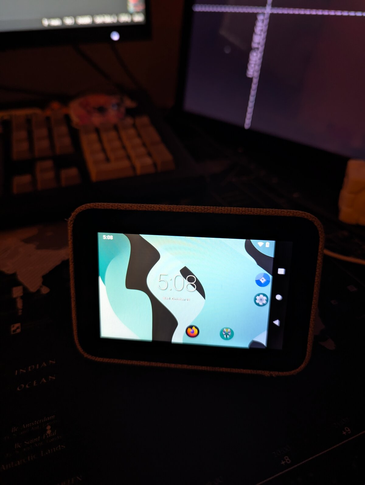
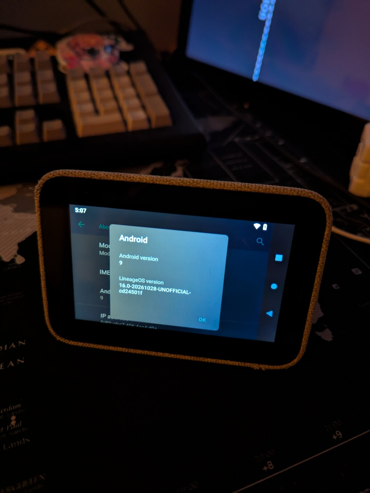
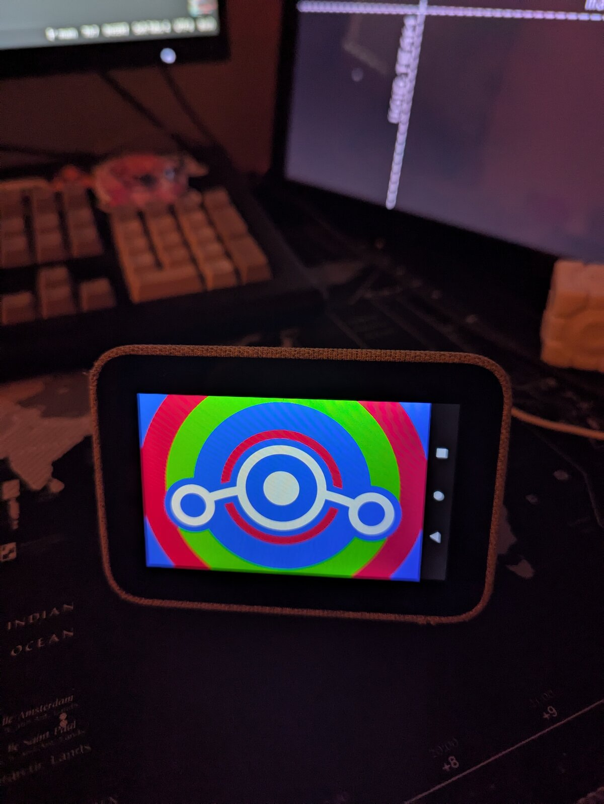

# LineageOS 16.0 for the Lenovo Smart Clock (CD-24501F)

LineageOS 16.0 (Android 9) on the Lenovo Smart Clock (MT8167S, 1 GB RAM, stock Android Things 8.1).
Display, touch, Wi-Fi, Bluetooth, speaker, volume keys and the mute slider work. See
[FINDINGS.md](FINDINGS.md) for status, hardware details and porting notes.

<p align="center">
  
  
  
</p>

Requires an unlocked bootloader and AVB. It installs to slot B and leaves stock on slot A.

## Layout

- `android/device/lenovo/cd24501f/`: device tree (`device/lenovo/cd24501f` in the LineageOS tree)
  - `patches/frameworks_base/`: framework patch, required (see FINDINGS.md, Display)
  - `smartclockd/`: daemon for the amp, mic ADC, volume keys and mute slider
- `kernel/cd24501f_defconfig`: kernel config for
  [deadman96385/android_kernel_lenovo_mt8167s](https://github.com/deadman96385/android_kernel_lenovo_mt8167s)
- `tools/`: flashing helpers for LK's unreliable fastboot

## Build

Clone this repo to `~/lenovo-smart-clock-lineage`, then in an empty directory for the LineageOS tree:

```sh
repo init -u https://github.com/LineageOS/android.git -b lineage-16.0 --depth=1
repo sync -c
# device tree, kernel and patch
cp -r ~/lenovo-smart-clock-lineage/android/device/lenovo/cd24501f device/lenovo/
git clone https://github.com/deadman96385/android_kernel_lenovo_mt8167s -b ivy-smart-display kernel/lenovo/mt8167s
cp ~/lenovo-smart-clock-lineage/kernel/cd24501f_defconfig kernel/lenovo/mt8167s/arch/arm64/configs/
git -C frameworks/base apply ../../device/lenovo/cd24501f/patches/frameworks_base/*.patch
# blobs, from https://github.com/deadman96385/things_mt8167s_som_dump
(cd device/lenovo/cd24501f && ./extract-files.sh "$(./stage-dump.sh /path/to/dump)")
. build/envsetup.sh && lunch lineage_cd24501f-userdebug && mka bacon
```

Optional: copy `~/.android/adbkey.pub` to `device/lenovo/cd24501f/adb_keys` to get adb without
confirming on screen.

## Flash

LK's fastboot stops reading USB when it's idle and hangs on the `getvar` queries the stock
`fastboot` client sends first. A command that is already waiting when the device enumerates does
go through. So start the command first and put the device in fastboot afterwards.

```sh
cd out/target/product/cd24501f
simg2img vendor.img vendor.raw
python3 ~/lenovo-smart-clock-lineage/tools/sparsesplit.py system.img system_chunk 94371840
# start this first; it waits up to 5 minutes for the device
python3 ~/lenovo-smart-clock-lineage/tools/fbmulti.py boot.img=boot_b vendor.raw=vendor_b \
    system_chunk.0=system_b ... system_chunk.5=system_b \
    vbmeta.img=vbmeta_b cmd:set_active:b
# then, from another terminal
adb reboot bootloader
```

`fbmulti.py` needs pyusb. Power-cycle the device when it prints `ALL DONE`. Format /data on first
install (see FINDINGS.md, Boot chain).

To go back to stock, the same trick works with the stock client: run `fastboot set_active a` first,
then put the device in fastboot or plug it in.

**Never flash `oem_*`, `oem_bootloader_*`, `lk`, `tee` or the preloader.**

## Disclaimer

This project was built with the help of AI (Claude Code). The released build was tested on real
hardware. Use at your own risk.

I'm not responsible for your device exploding, bending, falling apart or in any other way
deconstructing itself from a failed flash, broken zip alignment or thermonuclear wars between you
and the Lenovo CEO due to the usage of this ROM. Nor am I held accountable if you accidentally
reflash the image 3482 times causing your eMMC chip to die. If you have any concerns about the
features or modifications included in this port please do some research before flashing it. You
are choosing to make these modifications to your device.
